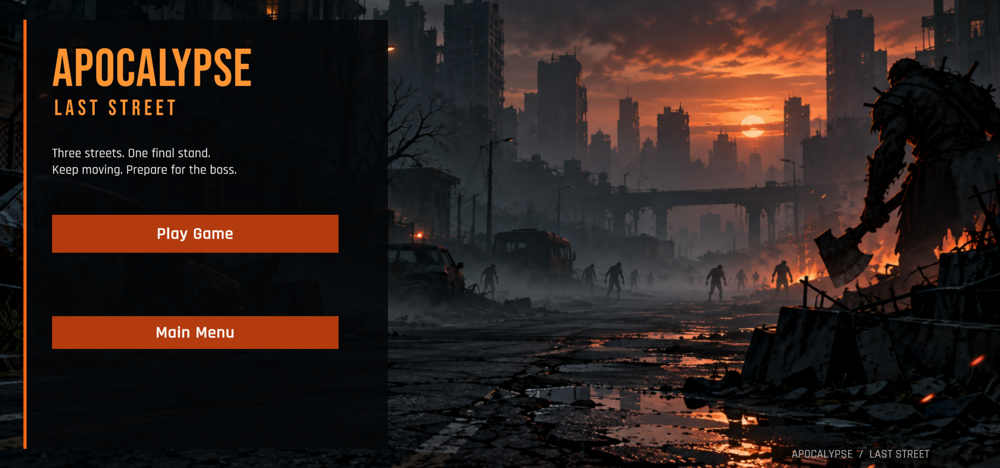
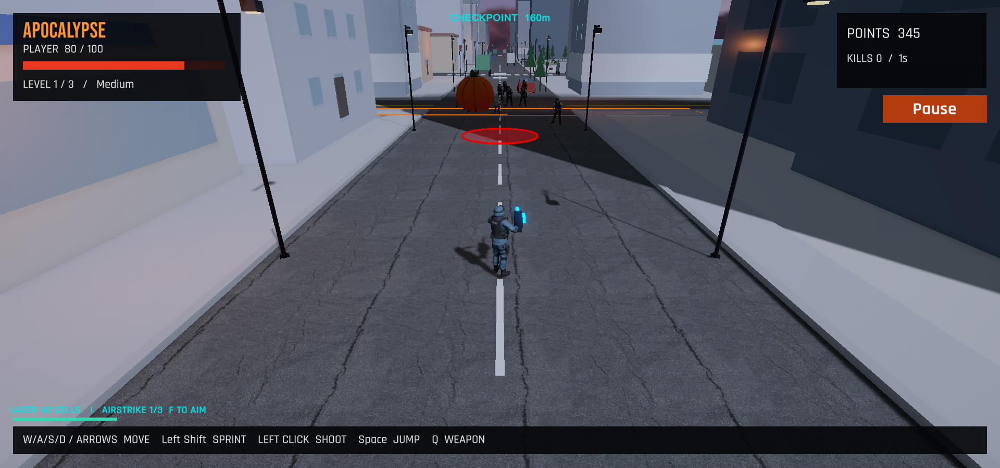
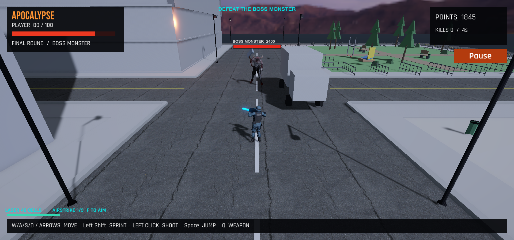

# Apocalypse: Last Street

**A Unity 6 / C# survival action game by Kingsley Eboh**

Survive a zombie-filled city street, cross three checkpoints, and face the Boss Monster in a final arena. The game combines movement and weapon systems with escalating enemies, telegraphed hazards, and a complete menu flow.

## Gameplay

- **Three-level campaign:** progression, saved checkpoints, death recovery, and victory flow.
- **Player systems:** movement, sprint stamina, jumping, aiming, and rifle / laser switching.
- **Combat and enemies:** pursuing zombies, damage, scoring, and a dedicated boss encounter.
- **Hazards:** missile warning circles and giant rolling pumpkins require the player to react and reposition.
- **Pickups:** health, laser ammunition, and stored airstrikes.
- **Difficulty:** Easy, Medium, and Hard adjust gameplay pressure.
- **Interface:** main menu, stats, credits, how-to-play, pause, settings, and saved key bindings.
- **Feedback:** animations, gun recoil, audio, visual effects, health bars, and ground warnings.

## What this repository contains

This is a **gameplay source and portfolio showcase**, not a standalone playable Unity distribution. It includes the project's 28 active C# scripts, screenshots, controls, and asset credits. Scripts are grouped by responsibility in the original project; the source archive preserves that structure.

The full local project uses third-party models, character animations, and effects. Those raw assets, Unity caches, and personal editor settings are excluded from this public repository. Opening these scripts alone will not recreate the scene or supply the referenced prefabs and assets.

## Code walkthrough

| System | Key scripts | Responsibility |
| :--- | :--- | :--- |
| Game flow | PumpkinGame, ApocalypseCampaign | Menus, campaign progression, difficulty, score, checkpoint save/restore |
| Player | PumpkinPlayer, PlayerControls, StreetBounds | Movement, stamina, jumping, input bindings, route boundaries |
| Weapons | PlayerArsenal, PumpkinEmber, GunAttachment, GunFeedback | Weapon switching, projectiles, hand attachment, recoil/audio |
| Enemies | SpawnManager, ZombieEnemy, AxePursuer, AxeSwing | Spawning, pursuit, attacks, boss combat and animation |
| Pickups | PowerupDirector, PathPowerup | Health, laser cells, and airstrike rewards |
| Hazards | MissileDirector, MarkedStrike, PumpkinHazardManager, RollingPumpkin | Incoming strikes, blast damage, and rolling obstacles |
| Presentation | PumpkinCamera, CheckpointGuide, GroundWarning, RunnerVfx, RunnerFeedback, HumanoidMotion | Camera, guidance, warnings, particles, and animation |
| Audio & editor | GameAudio, HorrorAudio, MixamoImportRules | Volume settings, sound playback, humanoid import rules |

Some class names retain the earlier pumpkin-player prototype naming. The current game is Apocalypse: Last Street.

## Running the full project

The original project uses **Unity 6000.0.56f1**. With the complete project and required assets available:

1. Open the project in the matching Unity editor.
2. Open Assets/Scenes/HalloweenCity.unity.
3. Press Play, choose Play Game, and select a difficulty.

### Default controls

| Input | Action |
| :--- | :--- |
| WASD | Move |
| Left Shift | Sprint |
| Space | Jump |
| Left mouse | Aim / shoot |
| Q | Switch rifle / laser when ammunition is available |
| F | Target a stored airstrike |
| Left / right mouse while targeting | Confirm / cancel airstrike |
| Escape | Pause / resume |

See [GAME_GUIDE.txt](GAME_GUIDE.txt) for checkpoint, pickup, difficulty, and settings details.

## Development focus

The project demonstrates interconnected gameplay systems: state-driven menus, persistent progression, difficulty tuning, enemy behavior, animation integration, and readable combat feedback. It was developed iteratively with AI assistance.

## Credits and asset scope

See [THIRD_PARTY_NOTICES.txt](THIRD_PARTY_NOTICES.txt) for model, audio, font, and other asset attributions from the original game. Screenshots show those assets in the game. Raw third-party asset packs are not included. No blanket open-source license is granted for third-party material.

---

**Kingsley Eboh** · [GitHub](https://github.com/kingsley259-coder) · [LinkedIn](https://www.linkedin.com/in/kingsley-eboh-636893330)
